# 1. What this guide is

Pulse is a system that, on its own and every cycle, scores each customer account's risk of cancelling or shrinking in the next 90 days, ranks the accounts a customer-success manager (CSM) should act on this week, shows **why** (down to the original source records), drafts a first message, and lets a human approve it. It runs for three simulated customer organisations ("workspaces") with about 5,000 accounts and 350,000 events from five systems.

This guide walks you through **every feature** as the right person, one step at a time. Each test says **what to do**, **what you should see**, and **what it means if you don't**. Screenshots show the real screens; a **red outline** marks what to click or look at.

**Time needed:** about two hours for everything. Parts A–E need only a browser. Part F (language-model drafting) needs a free local model that you install once.

**Contents**

| Part | What you will test |
|---|---|
| 2 | Before you start: who you sign in as, starting everything |
| A | Signing in and security: sessions, roles, one CSM versus another, workspace isolation |
| B | The weekly queue, browsing every account, history, evidence, "what moved", your judgement, low confidence |
| C | Drafts and email: review, the safety gate, demo mode, opt-outs, the mail inbox |
| D | The autonomous agent: run log, declined decisions, unattended worker, automatic sending |
| E | Administration: users, ownership, audit trail, settings, coverage, model card |
| F | Language-model drafting with a free local model |
| G | Things that are true, so you are not surprised; reset; checklist; hosting |

**Words you will meet**

| Word | Meaning |
|---|---|
| **Workspace** | One customer organisation (tenant). Data of one workspace is never visible in another. |
| **Operator** | An administrator of a workspace: sees every account, has the Admin page, can approve any draft. |
| **CSM** | A customer-success manager: sees **only the accounts they own**. |
| **Risk** | Probability (calibrated) that the account cancels or shrinks within 90 days. |
| **Value at risk** | Annual contract value × risk. Big accounts matter more. |
| **Queue** | The short, ordered list for this week, sized to the team's weekly capacity (12). |
| **Driver** | Why an account is flagged: Usage decline, Support experience, Relationship engagement, Payment friction, Commercial signals, or Data quality. |
| **Evidence** | The real source records (billing, support tickets, product usage…) behind a driver. |
| **Low confidence** | An account the system **refuses to score** because evidence is thin. Never shown as healthy. |
| **Draft** | A first message the agent prepared. A human reviews it; nothing is sent without the safety checks passing. |
| **Demo mode** | The default. Mail goes only to a test inbox (or is captured, delivering nothing). |

# 2. Before you start

## 2.1 Who you sign in as

The sign-in asks for **Workspace**, **Email** and **Password**. Every demo user shares one password. It is stored in the file `.demo-credentials.pulse` at the top of the project folder (the VS Code task **Pulse: show demo sign-ins** prints it).

| Role | Workspace | Email | What they can do |
|---|---|---|---|
| **Operator** (Dana Okafor) | `northwind` | `csm00@northwind.example.com` | Whole workspace, Admin page, approve any draft |
| **CSM** (Priya Rossi) | `northwind` | `csm01@northwind.example.com` | Only the accounts they own; no Admin page |
| Operator | `globex` | `csm00@globex.example.com` | A different organisation (1,700 accounts) |
| Operator | `initech` | `csm00@initech.example.com` | The smallest organisation (500 accounts) |

Use **two browser windows** where a test says "second window": one normal and one private (incognito), so the two sessions do not share a login.

## 2.2 Start everything

1. In VS Code press **Cmd+Shift+P** (the Command Palette), type **Tasks: Run Task** and press Enter. (Or use the menu **Terminal ▸ Run Task…**.)
2. Run **Pulse: 1. start Postgres**. It prints `postgres already running` if the database is already up.
3. Run **Pulse: 3b. run the demo with local mail (Mailpit + API + UI)**. It opens three terminal panels: the mail inbox, the API and the web app.
4. Wait about ten seconds until you see `Uvicorn running on http://127.0.0.1:8000` and `Local: http://localhost:5173/`.
5. Open **http://localhost:5173** for the app and **http://localhost:8025** for the mail inbox (keep both open in tabs).

> **If a panel says "Address already in use"**, an older copy is still running. Close the old `Pulse:` terminal panels (trash icon), then run the task **once**. Do not also run task 3 at the same time as 3b.

## 2.3 History for the week picker

The demo database already holds **9 weekly snapshots** (17 August to 12 October 2026). If you rebuild the database, add history again once (about 12 minutes):

`cd backend && source .venv/bin/activate && PGTZ=UTC python3 -m pulse.cli backfill --weeks 8`

## 2.4 How to read the tests

✅ means what you should see. ❌ means what it means if you do not. ✏️ marks a test that **changes data** in the demo database (the **Reset** section at the end undoes everything). 🧪 marks a test that should be run on a **scratch copy** (recipe in section D.5).

\newpage

# Part A — Signing in and security

## A1 · Sign in

**Why it matters:** nothing may be visible without a real session.

1. Open http://localhost:5173 in a private window.
2. ✅ You see only **Sign in to Pulse** with three fields. No account data is visible.
3. Enter workspace `northwind`, email `csm00@northwind.example.com` and the password, then click **Sign in**.

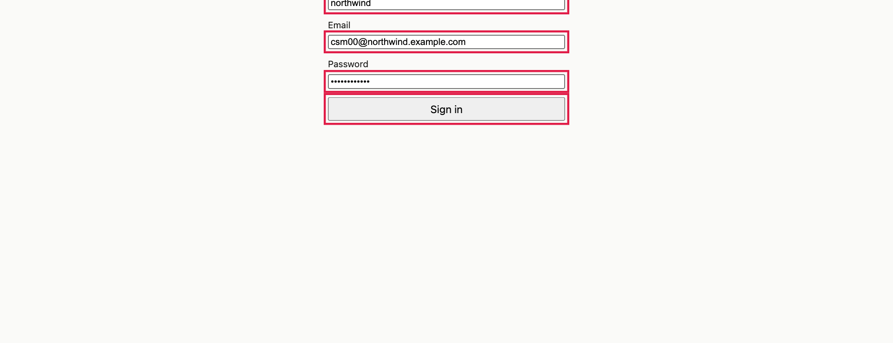{width=6.4in}

4. ✅ The top bar shows **Dana Okafor · operator · northwind** and the menu: **Queue · Low confidence · Drafts · Run log · Admin**.

{width=6.4in}

## A2 · A wrong password gives one generic message

1. Sign out (top right). Try a wrong password.
2. ✅ A red **invalid credentials**. Try a wrong workspace (`nowhere`) and a wrong email: ✅ **exactly the same message**, so an attacker cannot learn which part was wrong.

## A3 · Pages are protected when signed out

1. While signed out, open `http://localhost:5173/drafts`, `/admin` and `/runs`. ✅ Each shows the sign-in form, never data.
2. Open `http://localhost:8000/queue`. ✅ An error (`401`), not data.

## A4 · Login rate limiting ✏️ (locks one login for five minutes)

**Why it matters:** stops password guessing and spraying.

1. Sign out. Enter the **wrong** password **five times** for `csm01@northwind.example.com`.
2. ✅ On the **sixth** try, even with the **right** password, you get **too many attempts; try again later**.
3. Wait five minutes (or restart the API); ✅ it works again.

## A5 · Signing out really ends the session

1. Signed in, open the app in two tabs. In tab 1 click **Sign out**.
2. In tab 2 click **Queue**. ✅ You are asked to sign in: the session is dead on the server, not just hidden.

## A6 · A CSM sees only their own accounts

**Why it matters:** a real organisation has many CSMs; none may see another's book. The server enforces this, not just the screen.

1. **Window 1:** sign in as the operator. Open **Queue** and note the line **2254 more accounts below the weekly capacity cut**.
2. **Window 2 (private):** sign in as `csm01@northwind.example.com`.

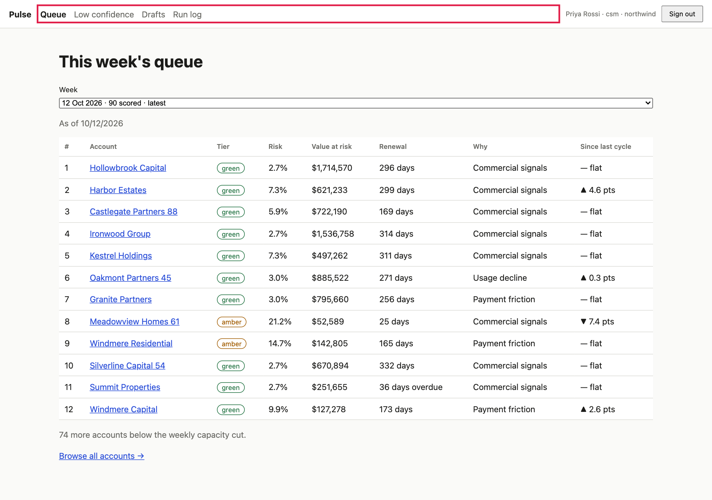{width=6.4in}

3. ✅ No **Admin** link, and the queue and "below the cut" number are much smaller.
4. In window 2 open `http://localhost:5173/admin`. ✅ **This page is for operators.**

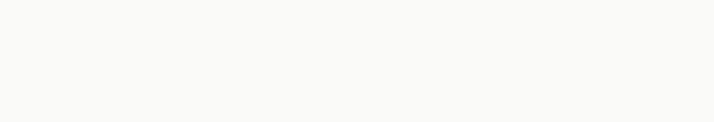{width=6.4in}

5. Copy an account link from the operator's queue that is not in the CSM's list and paste it in window 2. ✅ Not found. (The server answers "not found", which does not even confirm the account exists.)

## A7 · The server refuses the Admin API, not just the screen

In a terminal (replace `PASSWORD`):

```
curl -s -c /tmp/csm.txt -X POST localhost:8000/auth/login -H 'Content-Type: application/json' \
  -d '{"workspace":"northwind","email":"csm01@northwind.example.com","password":"PASSWORD"}'
curl -s -b /tmp/csm.txt localhost:8000/admin/outbound
```

✅ The first call returns the CSM's profile. The second returns `403`.

## A8 · One workspace cannot see another

Sign in as the **globex** operator (`csm00@globex.example.com`). ✅ Different accounts and a different queue size. A northwind account link pasted here is **not found**.

\newpage

# Part B — The queue, the evidence and your judgement

## B1 · The weekly queue

Sign in as the northwind operator and open **Queue**.

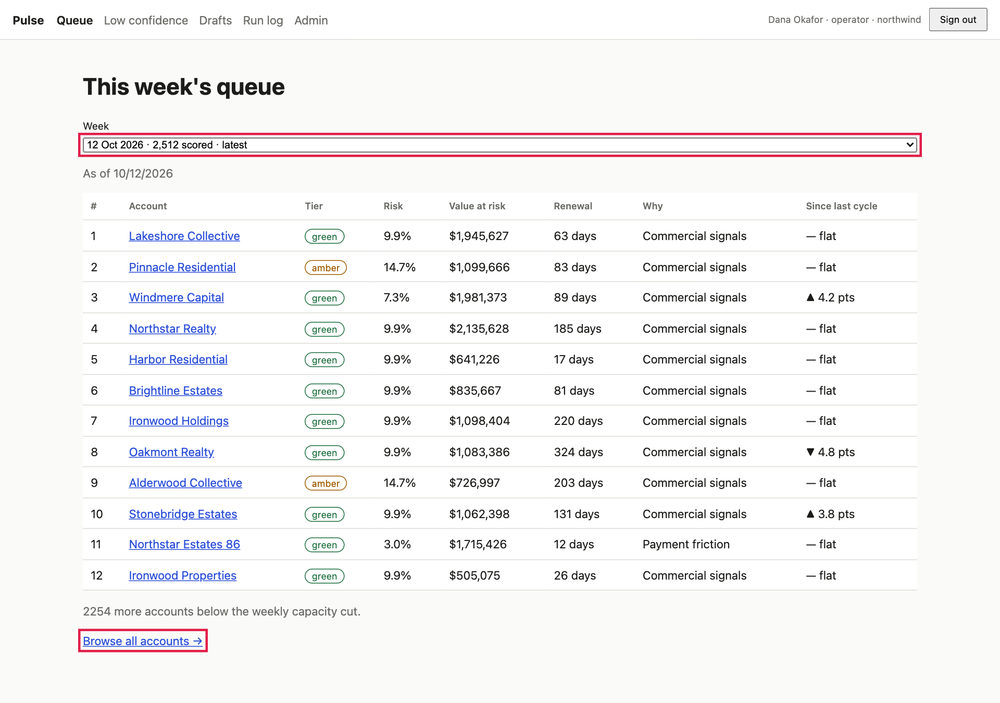{width=6.4in}

- ✅ **This week's queue** with a **Week** dropdown and **As of** date.
- ✅ A table of **12 rows** (the weekly capacity) with **#, Account, Tier, Risk, Value at risk, Renewal, Why, Since last cycle**.
- ✅ **Why** is one of the six drivers.
- ✅ Under the table: **2254 more accounts below the weekly capacity cut** and **Browse all accounts →**.

> **Do not be surprised** that many of the top 12 are green or amber. The order is *risk × value at risk × urgency*, so a very large account renewing soon can outrank a riskier small one. Only a handful of accounts (about 7) clear the red threshold at all. Risk on its own is therefore not sorted descending: that is intentional.

## B2 · The week picker and history

1. Open the **Week** dropdown. ✅ **Nine** weeks, newest first, the first marked **latest**, each with how many accounts were scored.
2. Pick an earlier week.

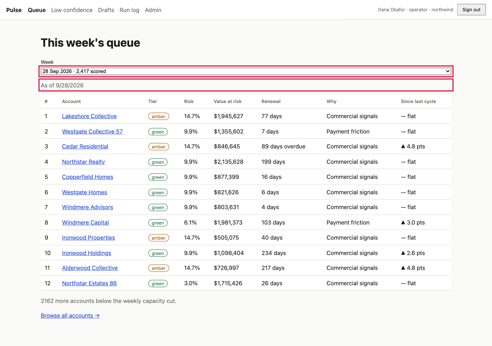{width=6.4in}

3. ✅ **As of** changes and the table reloads. The **Since last cycle** column shows **▲ / ▼ N pts** against the week before, and **— flat** where nothing moved. For the oldest week it reads **new** (nothing before it).
4. Choose **latest** again; ✅ the `?as_of` disappears.

## B3 · Browse every account (below the cut)

1. Click **Browse all accounts →**.

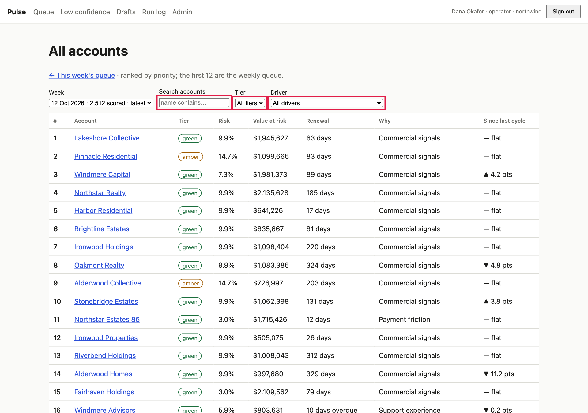{width=6.4in}

2. ✅ A table of **50 rows** with a **Showing 1–50 of 2,512** line. Ranks start at 1; the first 12 (the weekly queue) are in bold.
3. Click **Next**. ✅ **Showing 51–100**, and the first row is **51**: ranks continue, they do not restart.

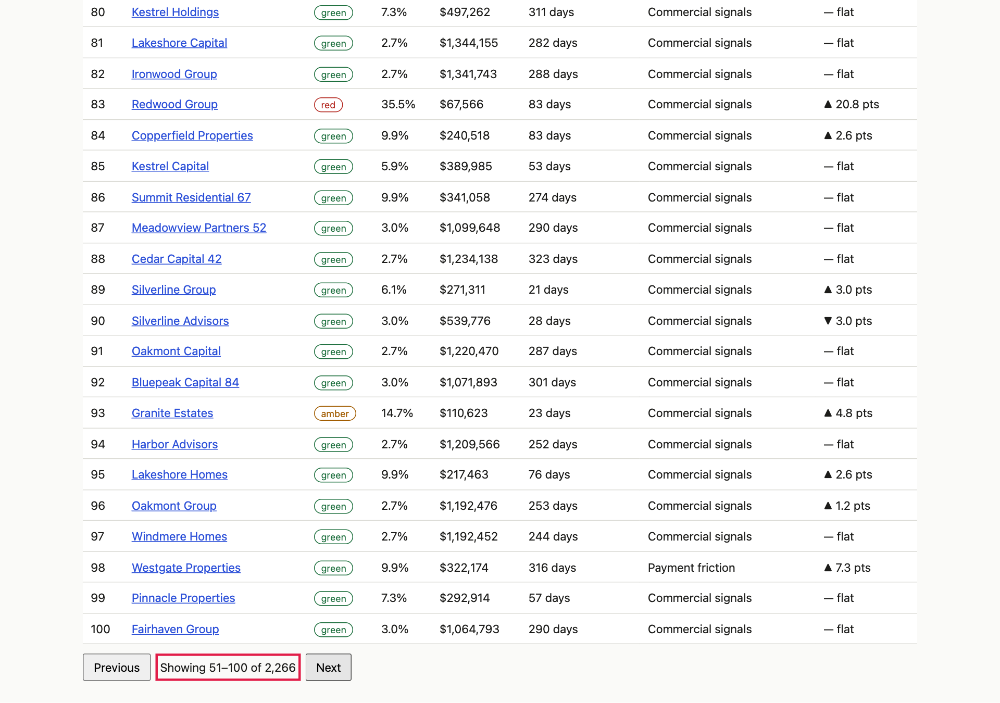{width=6.4in}

4. **Search:** type part of a name. ✅ The list narrows after a moment and every name contains your text.
5. **Filter:** choose **Tier = red** and **Driver = Payment friction**.

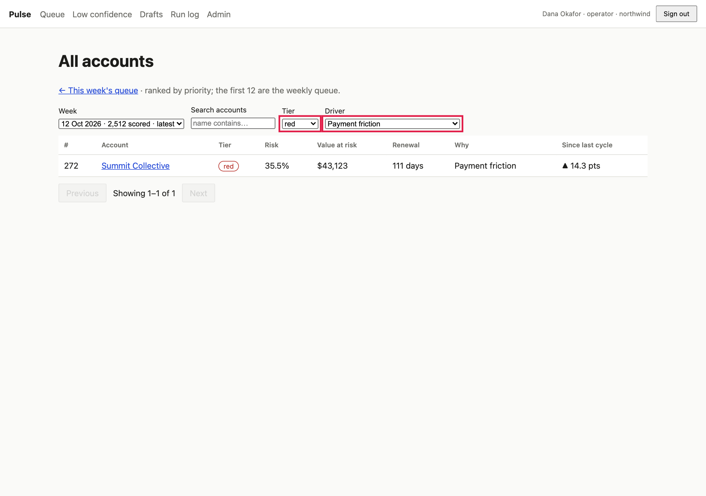{width=6.4in}

6. ✅ Only matching rows. Search for nonsense such as `zzzzqq`: ✅ **No accounts match.**
7. Change the **Week** here: ✅ the list changes, and **← This week's queue** returns you to the same week.

## B4 · The account page: why is it flagged?

Open any account from the queue.

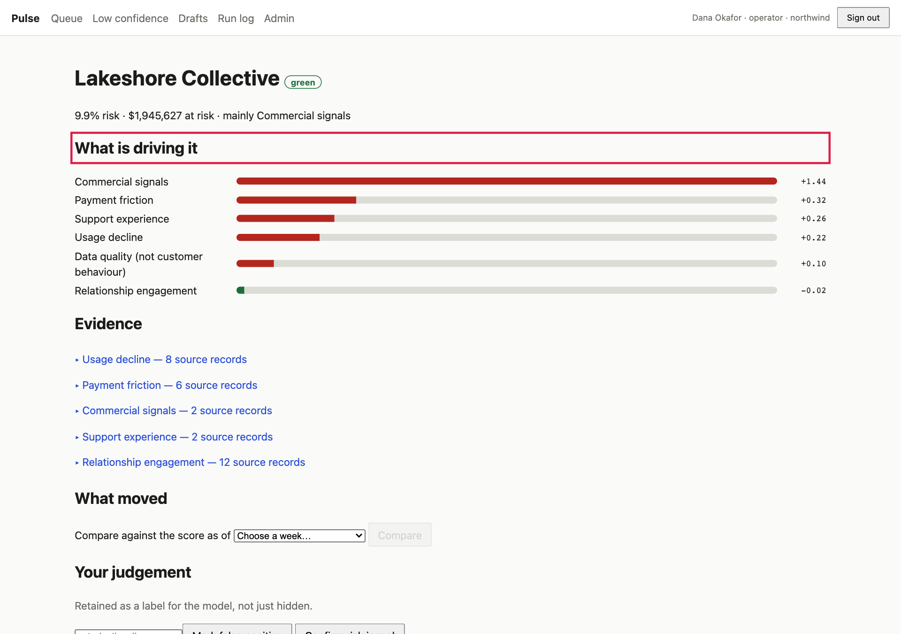{width=6.4in}

- ✅ A header with the account name and tier, then one line such as **9.9% risk · $1,945,627 at risk · mainly Commercial signals**.
- ✅ **What is driving it**: bars for the six drivers.
- ✅ **Evidence**: one line per driver. Click one, then click a record.

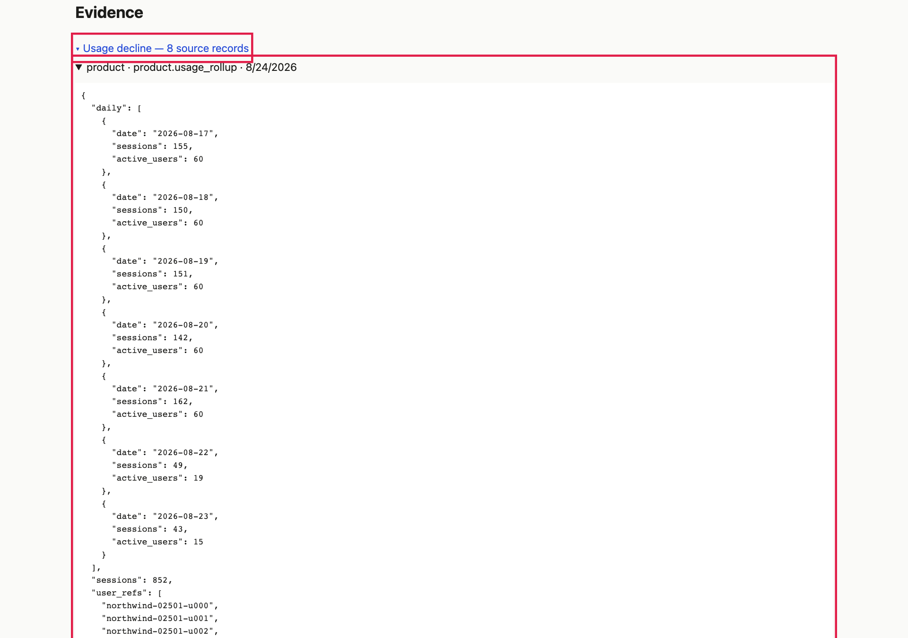{width=6.4in}

- ✅ **Feature values** (collapsed near the bottom) lists about 38 measurements. Where a source has no data it says **absent**. Absent is deliberately **not** zero.

## B5 · "What moved": compare two weeks

1. On the account page find **What moved**. In **Compare against the score as of**, choose an earlier week and click **Compare**.

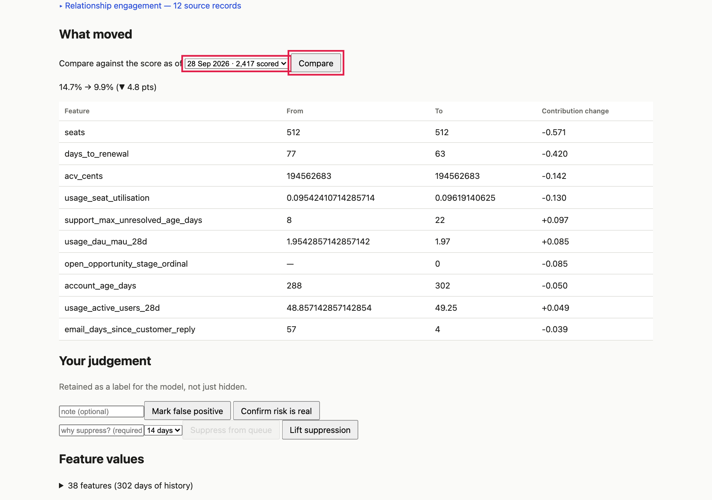{width=6.4in}

2. ✅ A line such as **14.7% → 9.9% (▼ 4.8 pts)** and a table **Feature · From · To · Contribution change**, biggest change first. This answers "why did it move" without a data request.
3. If the account did not exist in that week, you get a clear message in place of a table, not a crash.

## B6 · Your judgement: confirm, false positive, suppress ✏️

On the account page, scroll to **Your judgement**.

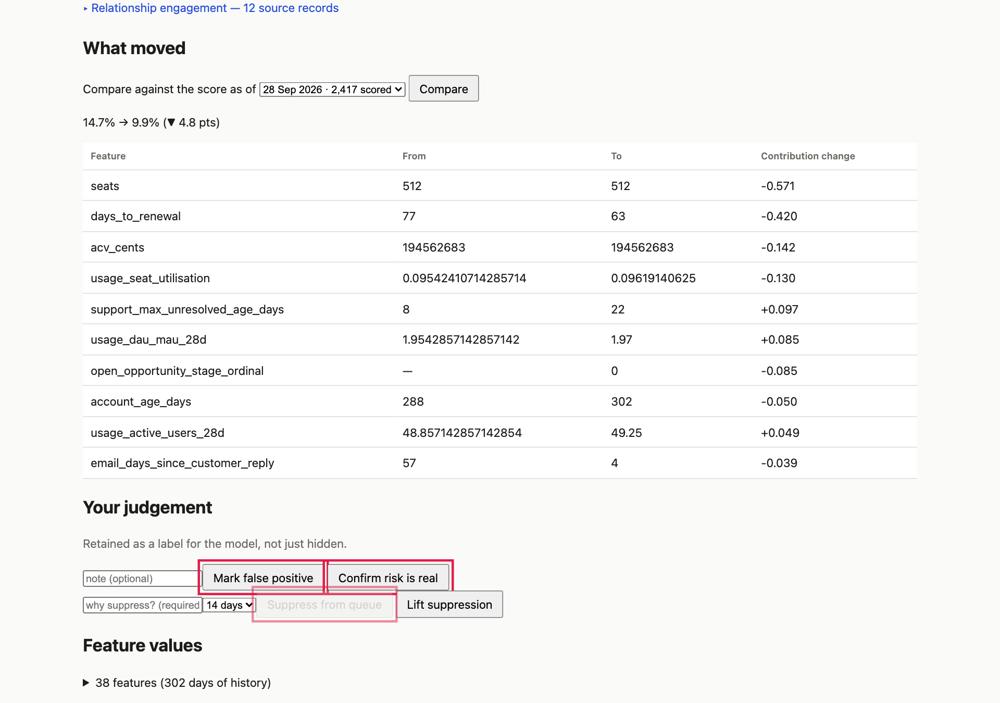{width=6.4in}

1. Type a note, then **Confirm risk is real**. ✅ "Recorded as a true positive." Try **Mark false positive**: ✅ "Marked as a false positive." Both are kept as labels the model can learn from.
2. **Suppress:** the button stays disabled until you give a **reason**. Enter one, choose **14 days**, click **Suppress from queue**. ✅ "Suppressed from the queue for 14 days; still scored."
3. Go to **Queue**. ✅ That account is gone from the top 12 and from Browse all, but it is still *scored*.
4. Return and click **Lift suppression**. ✅ It comes back.
5. As the **CSM**, repeat on one of *their* accounts (✅ works) and on another's (✅ not found).

## B7 · Low confidence: never shown as healthy

1. Open **Low confidence**.

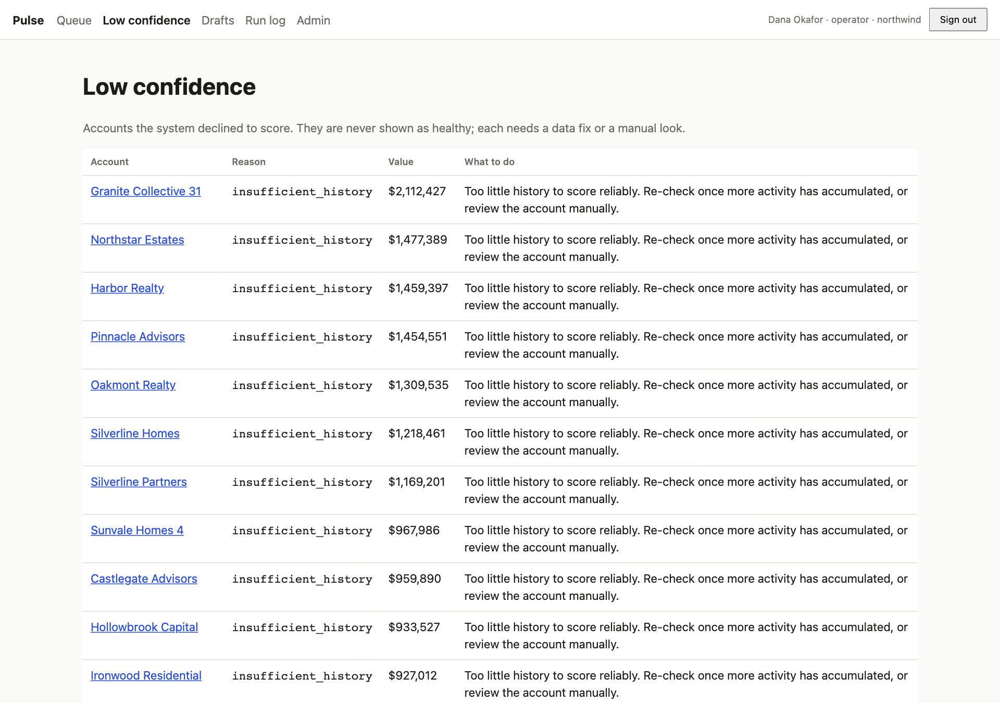{width=6.4in}

2. ✅ A table of accounts with a **Reason** (for example too little history or too few data sources) and a plain **What to do**.
3. Open one. ✅ It says **Not scored … This is missing evidence, not a clean bill of health**, with no green badge. None of these appear in the Queue or Browse all.

\newpage

# Part C — Drafts and email

**The idea.** The agent *prepares* a first message for each flagged account. A human reviews and approves it. Whether it is really sent depends on a safety gate: outbound switched **on**, a **verified** sender, a mail provider, a known customer contact, and no opt-out. In **demo mode** (the default) mail goes only to a test inbox. Test this hard: it is the system's safety net.

## C1 · Review a draft

Operator → **Drafts**.

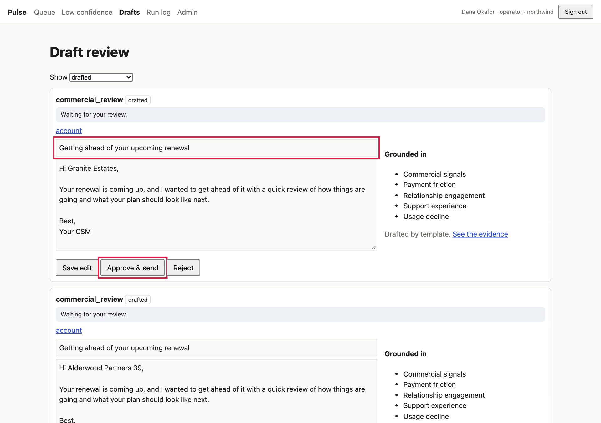{width=6.4in}

- ✅ Each card shows the play name (for example `commercial_review`), a state, and **Waiting for your review.**
- ✅ **Grounded in** lists the drivers behind the message and **Drafted by template** (or the model's name once Part F is on). The body mentions only facts the system derived.

## C2 · Edit a draft ✏️

Change the subject and a sentence, then **Save edit**. ✅ Reload: your edit stays and the state is still **drafted**.

## C3 · With outbound off, approving is blocked and says why ✏️

1. With outbound still off (a fresh install), click **Approve & send**.

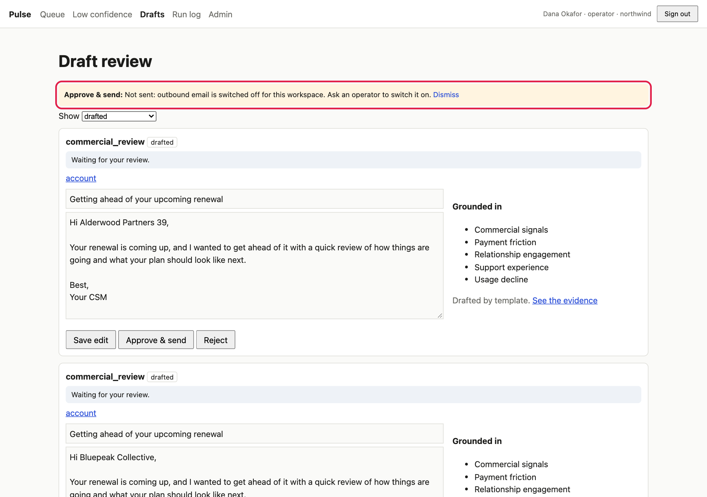{width=6.4in}

2. ✅ A banner: **Not sent: outbound email is switched off for this workspace. Ask an operator to switch it on.** The mail inbox (http://localhost:8025) stays **empty**.
3. The draft now has the state **outbound_disabled**. Choose that in the **Show** filter to find it; ✅ it can still be approved later (it definitely did not leave).

## C4 · Switch outbound on (Admin) ✏️

Operator → **Admin** → **Outbound email**.

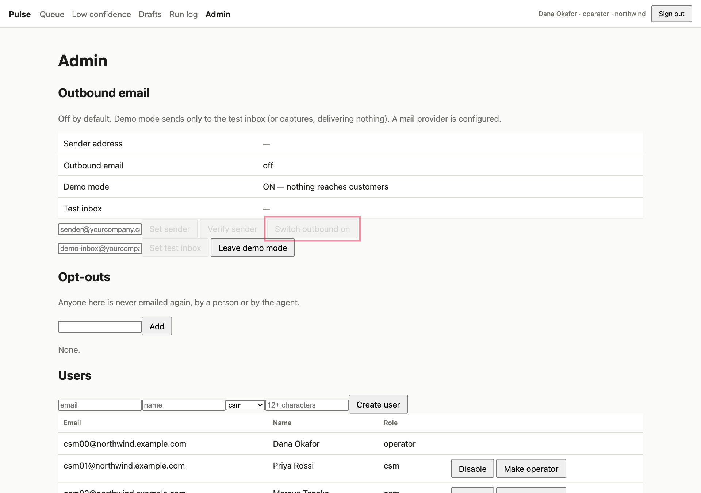{width=6.4in}

1. ✅ **Switch outbound on** and **Verify sender** are disabled. You cannot enable sending before a verified sender exists.
2. Enter `csm@northwind.example.com` under **Sender address** and click **Set sender** (✅ shows "not verified"), then **Verify sender** (✅ "✓ verified"), then **Switch outbound on** (✅ ON).
3. Enter `demo-inbox@northwind.example.com` under **Test inbox** and click **Set test inbox**.

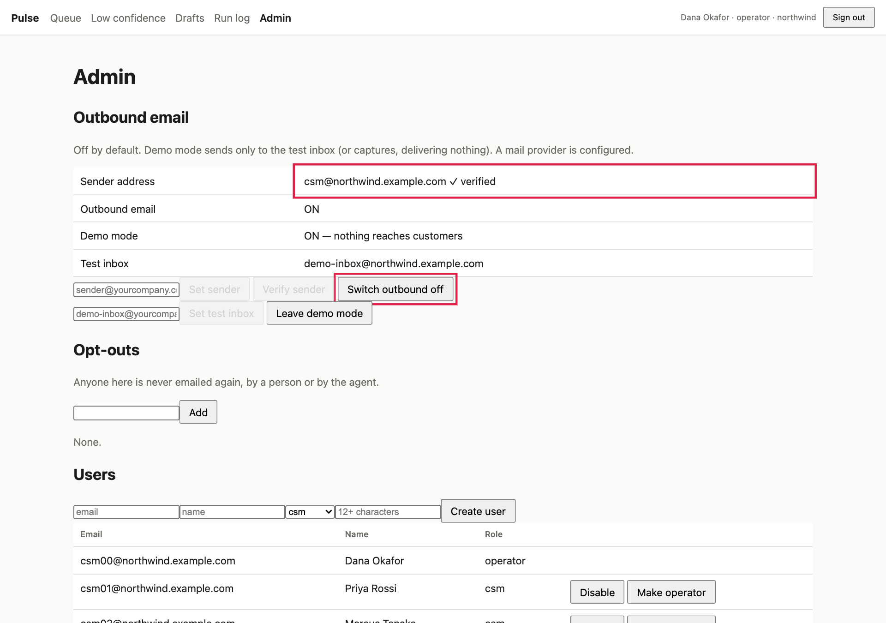{width=6.4in}

4. Change the sender address again. ✅ Verification is **revoked** and outbound switches **off** (a new address must be re-verified).

## C5 · Approve in demo mode: the email lands in the inbox ✏️

1. Redo C4.2–C4.3 if you changed the sender. **Drafts** → pick a draft (or filter **outbound_disabled**) → **Approve & send**.

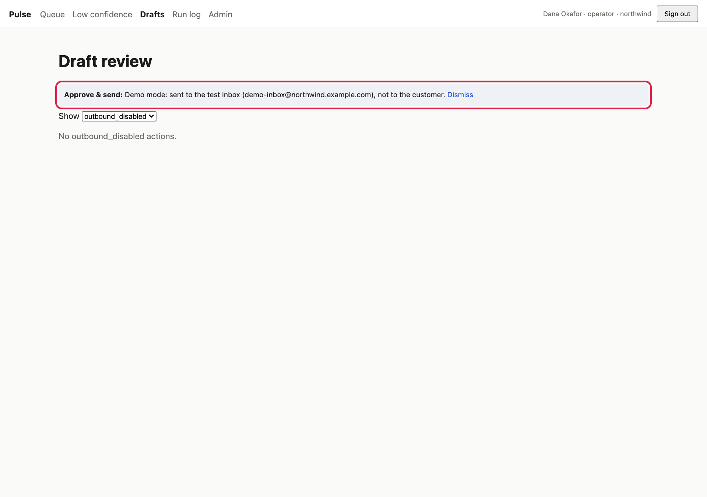{width=6.4in}

2. ✅ **Demo mode: sent to the test inbox (demo-inbox@northwind.example.com), not to the customer.**
3. Switch to the mail inbox tab (http://localhost:8025).

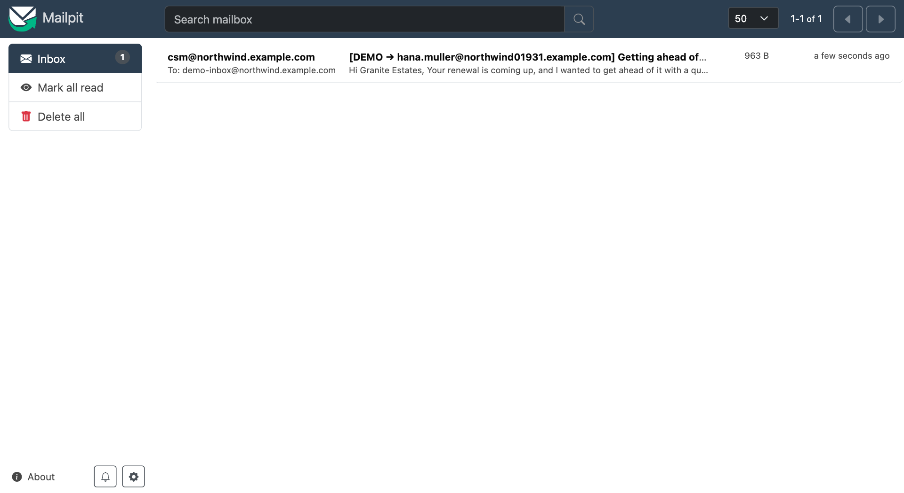{width=6.4in}

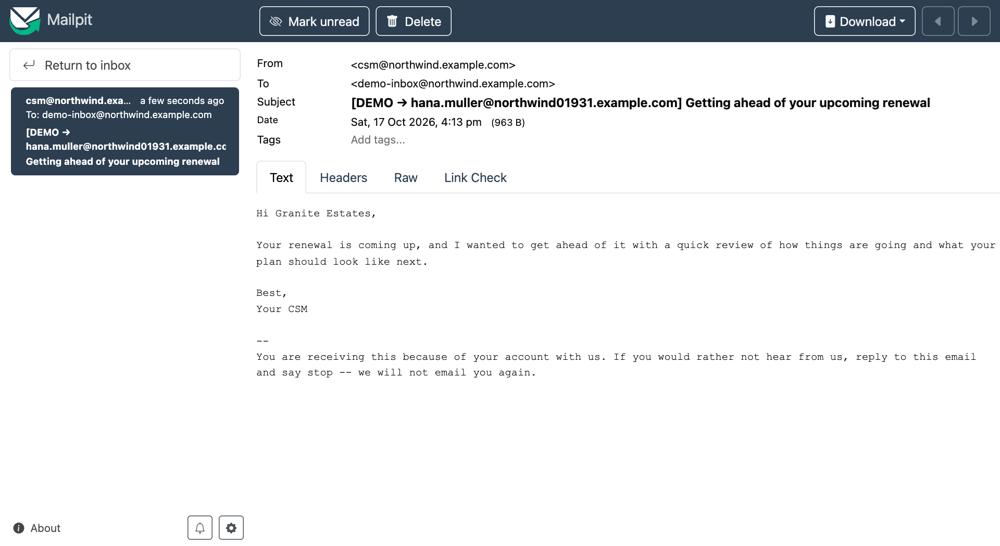{width=6.4in}

4. ✅ **To:** the test inbox; **From:** the verified sender; subject starting **[DEMO → the customer's real address]**; and a footer saying the customer can reply "stop".

## C6 · Approving twice sends once ✏️

On a sent draft there is no Approve button. Prove it at the API (after logging in as in A7, but as the operator, saving the cookie to `/tmp/op.txt`):

```
curl -s -b /tmp/op.txt -X POST localhost:8000/actions/<DRAFT_ID>/approve \
  -H 'Content-Type: application/json' -H 'X-Requested-With: pulse' -d '{}'
```

✅ The draft is returned still `sent`, and the inbox count does **not** change.

## C7 · Opt-outs are honoured ✏️

1. **Drafts** → pick a drafted card → click its **account** link and copy the account id from the address bar (`/accounts/<ACCOUNT_ID>`).
2. Look up that account's contact:
   `/opt/homebrew/opt/postgresql@16/bin/psql -h localhost -U pulse -d pulse -tAc "select contact_email from account where id='<ACCOUNT_ID>'"`
   (Nothing printed means no contact — choose another; that is test C10.)
3. **Admin → Opt-outs**: enter that address and click **Add**.

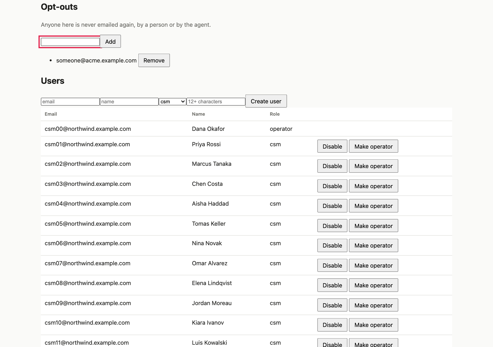{width=6.4in}

4. Back in Drafts, **Approve & send** that card. ✅ **Not sent: this contact asked not to be emailed.** The inbox is unchanged.
5. **Remove** the opt-out and approve again. ✅ It now sends (to the test inbox).

## C8 · Demo mode off: it goes to the real contact ✏️ (still only your local inbox)

1. **Admin → Leave demo mode.** ✅ "off — real customers are emailed".
2. Approve a fresh draft. ✅ In the inbox the message is **To the customer's own address**, with **no** `[DEMO →` prefix. (This is real SMTP to your local inbox only, so no real person is contacted. **With a real provider this would be a real email — never leave demo mode off on a real deployment unless you mean it.**)
3. **Admin → Back to demo mode.**

## C9 · Reject ✏️

On a **drafted** card click **Reject**. ✅ State **rejected**. Filter **rejected**: it is there, read-only. A rejected draft cannot be approved (the server answers "action was rejected and cannot be approved").

## C10 · An account with no contact cannot be emailed ✏️

About 12% of accounts have no known contact (a realistic CRM gap). Approve drafts until one reports **Not sent: this account has no known contact. Add one in the CRM.** ✅ The inbox is unchanged.

## C11 · The command-line mail check

```
cd backend && source .venv/bin/activate
PULSE_SMTP_HOST=127.0.0.1 PULSE_SMTP_PORT=1025 PULSE_SMTP_STARTTLS=false \
  python3 -m pulse.cli send-test --to me@example.test --sender pulse@example.test
```

✅ **delivered to the provider for me@example.test**, and the inbox shows **Pulse test message**. With a wrong port (`PULSE_SMTP_PORT=1`) it prints **FAILED** with advice.

\newpage

# Part D — The autonomous agent

## D1 · The run log

Any user → **Run log**.

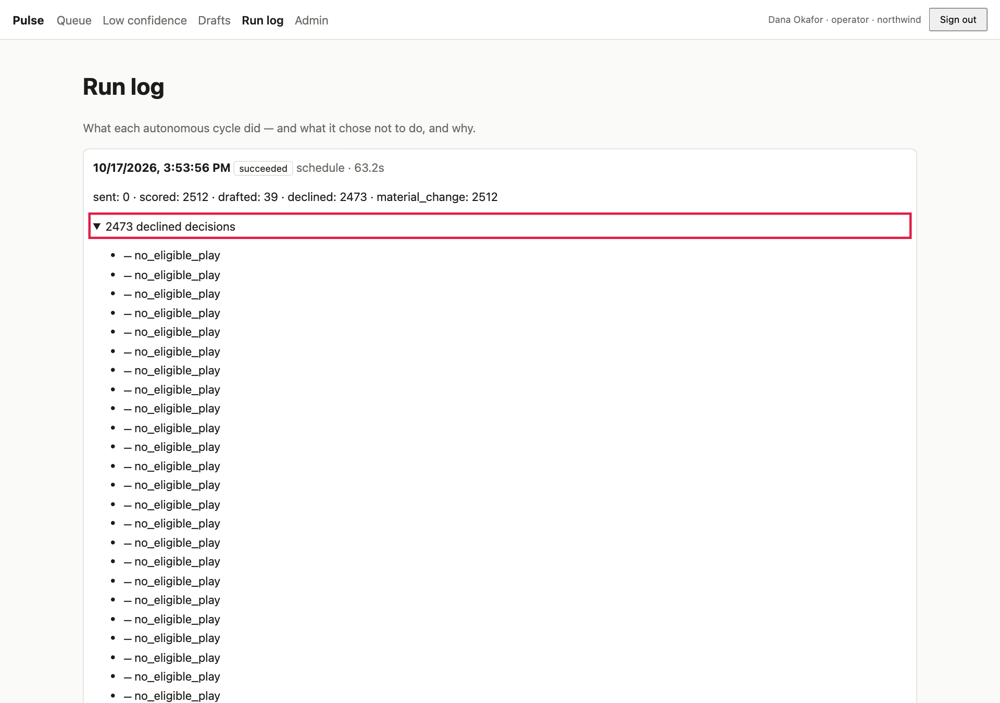{width=6.4in}

- ✅ One card per cycle: time, **status** (`succeeded`), duration and counts such as **scored · material_change · drafted · sent · declined**.
- ✅ **N declined decisions** opens a list. *What the agent chose not to do, and why* is as visible as what it did.

## D2 · Why it declines: read the reasons

| Reason | Meaning |
|---|---|
| `no_eligible_play` | The score moved materially but no play fits that driver and tier. |
| `suppressed` | A human suppressed the account (try B6, then run a cycle in D4). |
| `suppression_window_active` | The agent already contacted this account within the last 14 days. |
| a grounding reason | The draft said something the evidence does not support, so it was discarded. |
| `send_blocked:<state>:…` | The send gate stopped an automatic send. |

Not a decline: when a play is not allowlisted, or the per-cycle send cap (30) is reached, the draft is still **created** for a human to review and is simply not sent automatically.

## D3 · The unattended worker ✏️

1. Run the task **Pulse: 4. unattended worker**. It prints `pulse worker: 3 tenants, model ready; cycle every 15 min…`.
2. For a quick demo, stop it and run: `cd backend && source .venv/bin/activate && PGTZ=UTC PULSE_CYCLE_INTERVAL_MINUTES=1 python3 -m pulse.cli serve --simulate-present`.
3. Refresh **Run log** every minute. ✅ A new **succeeded** run per workspace each interval with nobody clicking anything. `drafted: 0` is correct when no new data arrived.
4. Stop with **Ctrl-C** (✅ "stopped"). Starting two workers is safe: a lease lets only one process a workspace at a time.

## D4 · Autonomous sending, gated by an operator allowlist 🧪 (sends up to 30 emails — use a scratch copy)

**Why it matters:** auto-emailing customers is the riskiest thing the system can do. By default **no play auto-sends**; an operator must allowlist each play.

1. Make a scratch copy (D5) and run its API on port 8001 with the mail settings.
2. Log in as the operator (cookie file `/tmp/op.txt`), set up outbound as in C4, then:

```
curl -s -b /tmp/op.txt localhost:8001/admin/allowlist     # ✅ []   nothing auto-sends by default
curl -s -b /tmp/op.txt -X PUT localhost:8001/admin/allowlist/adoption_nudge \
  -H 'Content-Type: application/json' -H 'X-Requested-With: pulse' -d '{"auto_send":true}'
```

3. Run one cycle a week after the newest snapshot: `python3 -m pulse.cli cycle --as-of 2026-10-19T09:00:00+00:00`.
4. ✅ The output shows `sent: 30` for northwind (the per-cycle cap). The inbox gains about 30 messages, each tagged `[DEMO → …]`, all to the test inbox. The other drafts wait in **Drafts** for a human. Switch the allowlist off (`{"auto_send":false}`) and rerun: ✅ `sent: 0`.

## D5 · Scratch-copy recipe

```
B=/opt/homebrew/opt/postgresql@16/bin
$B/createdb -h localhost -U pulse pulse_scratch
$B/pg_dump -h localhost -U pulse pulse | $B/psql -h localhost -U pulse -d pulse_scratch -q -o /dev/null
cd backend && source .venv/bin/activate
export PGTZ=UTC PULSE_DATABASE_URL_OWNER="postgresql+psycopg://pulse@/pulse_scratch?host=/tmp&port=5432" \
  PULSE_DATABASE_URL_APP="postgresql+psycopg://pulse_app:pulse_app@/pulse_scratch?host=/tmp&port=5432" \
  PULSE_SMTP_HOST=127.0.0.1 PULSE_SMTP_PORT=1025 PULSE_SMTP_STARTTLS=false
uvicorn pulse.api.main:app --port 8001      # leave running; use localhost:8001 in the curl examples
# when finished:  $B/dropdb -h localhost -U pulse --force pulse_scratch
```

\newpage

# Part E — Administration (operators only)

## E1 · Users ✏️

Operator → **Admin → Users**.

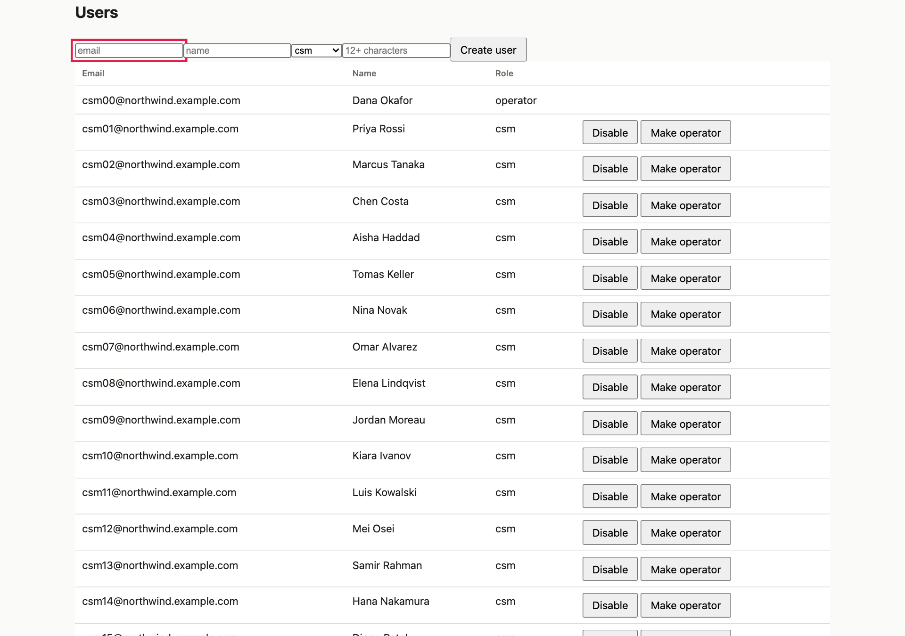{width=6.4in}

1. **Create a user**: email `tester@northwind.example.com`, name `Test Tester`, role **csm**, a password of 12+ characters → **Create user**. ✅ They appear in the table. A short or common password is refused with a reason.
2. Sign in as that user in window 2. ✅ It works: an empty queue (they own no accounts) and no Admin link.
3. Click **Make operator** on them. ✅ Their role changes; they gain the Admin page after their next request.
4. Click **Disable**. ✅ The row greys out. In window 2 click anything: ✅ they are signed out on the next request, and sign-in fails with **invalid credentials**.
5. ✅ You cannot disable or demote yourself (no buttons on your own row).

## E2 · Giving a CSM accounts ✏️

Accounts are owned by one user; only the owner (and operators) see them.

1. Get the CSM's id from `curl -b /tmp/op.txt localhost:8000/admin/users` and an account id from an account page address.
2. Assign it:

```
curl -s -b /tmp/op.txt -X PATCH localhost:8000/admin/accounts/<ACCOUNT_ID> \
  -H 'Content-Type: application/json' -H 'X-Requested-With: pulse' -d '{"owner_user_id":"<USER_ID>"}'
```

3. ✅ In window 2 (that CSM) the account now appears in Browse all and can be opened. Send `"owner_user_id":null` to unassign it.

## E3 · The audit trail ✏️

Admin → **Audit trail** (bottom of the page).

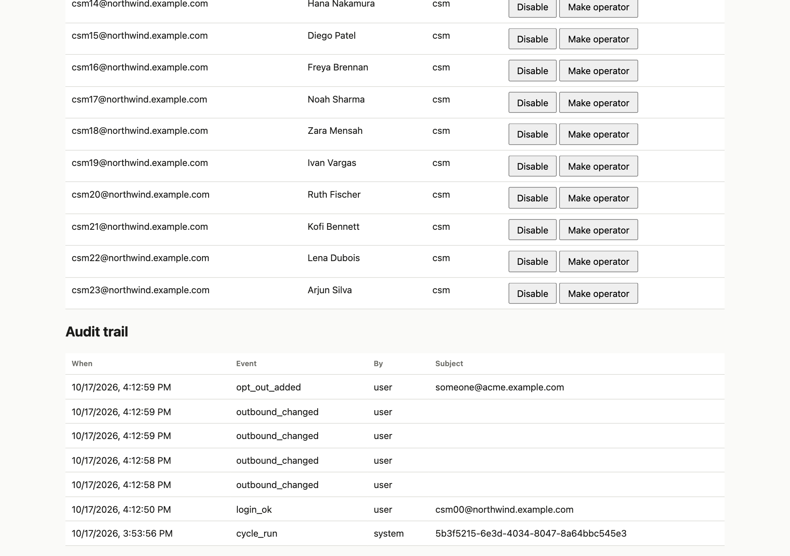{width=6.4in}

- ✅ Recorded here: **login_ok / login_failed / logout, user_created, user_enabled / user_disabled, role_changed, password_reset, outbound_changed, opt_out_added / opt_out_removed, cycle_run**.
- ℹ️ **Not** in this list: draft approve / reject / edit and allowlist changes. Those are recorded on the draft itself (who decided, when) and on the allowlist row (who enabled it). That is a known gap.

## E4 · Per-workspace settings (API) ✏️

```
curl -s -b /tmp/op.txt localhost:8000/admin/config
curl -s -b /tmp/op.txt -X PATCH localhost:8000/admin/config \
  -H 'Content-Type: application/json' -H 'X-Requested-With: pulse' -d '{"weekly_capacity":5}'
```

✅ Reload **Queue**: now **5 rows** and the "below the cut" number grows by 7. Set it back to `12`. ✅ An unknown field (`{"banana":1}`) is rejected (`422`).

## E5 · Data coverage per source (API)

`curl -s -b /tmp/op.txt localhost:8000/admin/coverage`

✅ One entry per source (salesforce, gmail, zendesk, product, stripe): whether it is connected, events landed, **unresolved events** (records that could not be tied to an account — surfaced, never silently dropped, never creating phantom accounts) and the date last received.

## E6 · The model card (API)

`curl -s -b /tmp/op.txt localhost:8000/model | python3 -m json.tool | head -80`

- ✅ **Operating point:** precision at weekly capacity about **0.29**, against about 0.04 for a trivial baseline and 0.02 for a hand-built heuristic. **ROC-AUC about 0.69.**
- ✅ **Per-workspace** results, and **leave-one-workspace-out**: a small new workspace (initech) gets almost nothing from the shared model (ROC-AUC about 0.53).
- ✅ Anything the pipeline could not produce says **available: false** with a reason (for example lead time). It is stated, not invented. A CSM gets `403` here.
- Honest reading: the model is moderately useful, not magic.

\newpage

# Part F — Language-model drafting (free, local)

**What it is.** A language model *only writes the prose* of a draft from facts the system already derived. It never ranks, scores or filters anything, and the system produces identical scores with it off, on or failing. Without a model, every draft is a deterministic template.

**You do not need a paid key.** The drafting code speaks the common "OpenAI-style" protocol, so it works with a **free model running on your own Mac** (Ollama), and also with hosted providers that have free tiers. Switching to Anthropic later is one setting.

## F1 · Install a free local model (once, about 5 minutes)

```
brew install ollama
ollama serve &                 # starts the local model server on port 11434
ollama pull qwen2.5:7b         # about 4.7 GB; a good small instruction-following model
```

## F2 · Run a cycle with the model switched on 🧪 (use a scratch copy)

```
PULSE_LLM_ENABLED=true PULSE_LLM_PROVIDER=openai_compatible \
PULSE_LLM_BASE_URL=http://127.0.0.1:11434/v1 PULSE_LLM_MODEL=qwen2.5:7b \
  python3 -m pulse.cli cycle --as-of 2026-10-19T09:00:00+00:00
```

(Run it with the scratch-copy settings from D5.) Calls are capped per cycle (50 by default); the remaining drafts use templates.

## F3 · What to check

1. **Drafts:** ✅ newer cards say **Drafted by llm** and name the model.

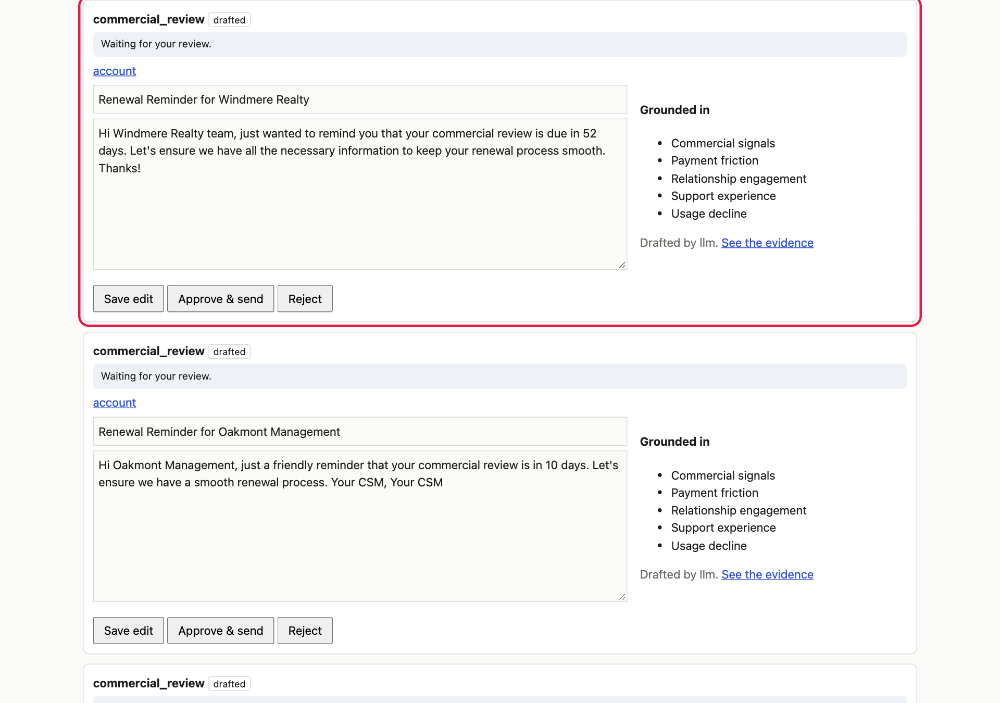{width=6.4in}

2. **Guardrails:** read several. ✅ No numbers, links or claims that are not in the facts; plain prose; no markdown. A reply containing anything unsupported is **rejected and a template is used instead**.
3. **Failure is safe:** set `PULSE_LLM_BASE_URL=http://127.0.0.1:1/v1` (nothing listening) and rerun. ✅ The cycle still **succeeds**, every draft falls back to a template, and scores are identical.
4. **Same scores either way:** ✅ ranks and risks are identical with the model on, off or failing.

## F4 · Other providers (later)

| Provider | Settings | Notes |
|---|---|---|
| **Ollama / LM Studio** (local) | `PULSE_LLM_PROVIDER=openai_compatible`, `PULSE_LLM_BASE_URL=http://127.0.0.1:11434/v1`, no key | Free, private, slower on a laptop |
| **Hosted with a free tier** (Groq, OpenRouter, Google Gemini's OpenAI-compatible endpoint) | same provider, the provider's base URL, `PULSE_LLM_API_KEY=<their key>`, `PULSE_LLM_MODEL=<their model name>` | Free tiers and limits change; check the provider |
| **Anthropic Claude** | `PULSE_LLM_PROVIDER=anthropic`, `PULSE_LLM_API_KEY=<key>`, `pip install -e ".[llm]"` | Needs an API key (separate from a chat subscription) |

# Part G — Things that are true, so you are not surprised

- **The weekly queue is dominated by large renewals**, not only red accounts, by design (risk × value × urgency). Only about 7 accounts are red.
- **Backfilled history is in-sample:** the model learned from those same weeks, so earlier weeks flatter it. Use them to browse and compare, not to judge the model.
- **No real email provider has been exercised.** The local inbox is real SMTP, but STARTTLS, authentication, rate limits, bounces and spam filtering are untested. Bounces and replies are not processed.
- **A free local model writes plainer, sometimes slightly awkward prose** than a frontier model. The guardrails, not the model, are what make it safe.
- **All demo users share one password**; there is no SSO or MFA; cookies are not marked `Secure` (needs HTTPS); the app's database role passwords are development defaults.
- **Account names repeat** within a workspace (as in a real CRM). Drafts for accounts with no CRM record greet by reference and cannot be sent.
- **Model quality:** ROC-AUC about 0.69. The two planted "lost renewal" accounts are missed, lead time is not reported, and a small new workspace gets little from the shared model.
- **All data is simulated;** addresses end in `@example.com`.

# Reset

- **Undo your test data** (users, opt-outs, outbound settings, approved drafts): run the task **RESET demo database**, then **Pulse: 2. build demo data** (about 4 minutes), then the backfill in 2.3 (about 12 minutes).
- **Clear the mail inbox:** in the inbox choose **Delete all**.
- **Stop everything:** close the task panels; `pkill mailpit`.

\newpage

# Appendix — One-page checklist

| # | Feature | Where | Pass? |
|---|---|---|---|
| A1–A3 | Sign-in, generic error, protected pages | Sign-in, `/drafts` | ☐ |
| A4 | Rate limit | Sign-in ×6 | ☐ |
| A5 | Sign-out kills the session | Two tabs | ☐ |
| A6–A8 | CSM scoping, Admin API refused, workspace isolation | Two windows | ☐ |
| B1–B2 | Queue, week picker, history | Queue | ☐ |
| B3 | Browse all: paging, search, filters | All accounts | ☐ |
| B4–B5 | Account, evidence, What moved | Account page | ☐ |
| B6 | Confirm / false positive / suppress / lift | Account page | ☐ |
| B7 | Low confidence | Low confidence | ☐ |
| C1–C2 | Draft review and edit | Drafts | ☐ |
| C3–C4 | Blocked when off; configure outbound | Drafts, Admin | ☐ |
| C5–C6 | Email arrives in the inbox; no double send | Mail inbox | ☐ |
| C7–C10 | Opt-out, demo off, reject, no contact | Drafts, Admin | ☐ |
| C11 | Command-line mail check | Terminal | ☐ |
| D1–D3 | Run log, declined reasons, unattended worker | Run log | ☐ |
| D4 | Allowlisted automatic sending | Scratch copy | ☐ |
| E1–E3 | Users, ownership, audit | Admin | ☐ |
| E4–E6 | Settings, coverage, model card | API | ☐ |
| F | Free local model drafting | Scratch copy | ☐ |

# Appendix — Hosting this for a reviewer

Nothing in the hosting section below has been done yet; it is what the research found.

| Option | Cost | Fit |
|---|---|---|
| **Your Mac plus a Cloudflare quick tunnel** (`cloudflared tunnel --url http://localhost:5173`) | Free, no account | Public link while your laptop is on; the address changes each run. Good for a live review slot. |
| **AWS** | New accounts get credits ($100, up to $200) on a Free Plan that **ends after six months or when the credits run out, and then closes the account**. A 4 GB server costs roughly $25–30 a month, so credits cover a short review period. | Works. The containers are verified on ARM, so choose a Graviton server (t4g.medium). Needs a card. Lower cost-surprise risk than the paid plan because the free plan closes instead of billing. |
| **Oracle Cloud Always Free ARM** | Free, but reportedly cut to about 2 CPUs and 12 GB in 2026 | Durable but fiddly signup and capacity |
| **Render free tier** | Free | Does not fit: sleeps, no free background worker, free database expires after 30 days |

Before any public hosting: set the `PULSE_COOKIE_SECURE`, `POSTGRES_PASSWORD` and `PULSE_DEMO_PASSWORD` settings, keep demo mode on, and put no mail or model keys on the server.
